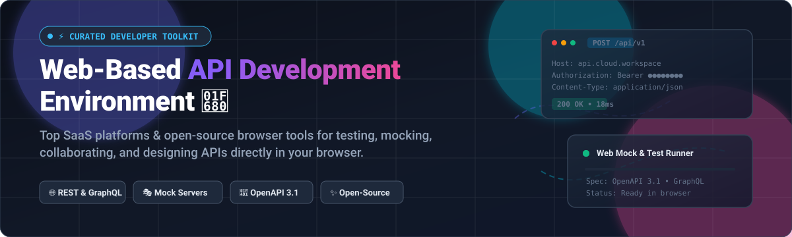
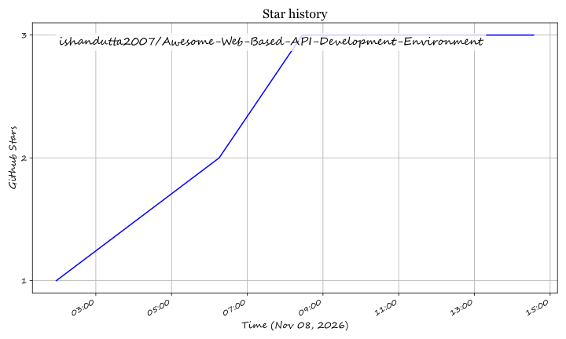

# 🌐 Awesome Web-Based API Development Environment 🛠️

  

> 🚀 A curated list of the best **Web-Based API Development Environment** platforms, browser-based REST/GraphQL clients, API testing suites, mock servers, and interactive specification tools. Covers both commercial SaaS/cloud platforms and self-hosted open-source alternatives.  
> 🌟 *Star this repository if you find it helpful!* 🌟

---

## 📋 Table of Contents 📑

- [📈 Sector Overview & Market Dynamics](#-sector-overview--market-dynamics-)
- [🟦 SaaS / Hosted Platforms](#-saas--hosted-platforms-)
- [🟩 Open-Source Software](#-open-source-software-)
- [📊 Comparison at a Glance](#-comparison-at-a-glance-)
- [🔍 SEO Keywords & Search Queries](#-seo-keywords--search-queries-)
- [🤝 Contributing](#-contributing-)
- [💖 Support & Community](#-support--community-)
- [⭐ Star History](#-star-history-)
- [📄 License](#-license-)

---

## 📈 Sector Overview & Market Dynamics 📊

The global API management and development tooling market is estimated at **$6.89B – $9.50B** (projected to reach over **$13.5B+** by 2026 at a CAGR of ~15–25%), driven by enterprise microservices, AI agent integrations, and API-first architectures. 

The sector is **moderately fragmented**: while cloud giants (Oracle, Broadcom, Google, AWS) and dominant platforms like Postman lead enterprise mindshare, the space resists a winner-take-all monopoly due to developer resistance against vendor lock-in, fueling thriving demand for agile, local-first, and open-source alternatives.

---

## 🟦 SaaS / Hosted Platforms ☁️

Commercial, cloud-hosted Web-Based API Development Environment platforms sorted in descending order by parent company scale (market capitalization, valuation, or estimated annual revenue).

| Platform 🚀 | Parent Company / Scale (Valuation / Revenue) 🏢 | Starting Paid Tier Pricing 💳 | Free Tier / Trial Limits 🎁 | Key Highlights 💡 |
|:---|:---|:---|:---|:---|
| **[Runscope](https://www.runscope.com/)** | **Broadcom / Perforce** ~$1.4T Market Cap (Broadcom) / ~$89B TTM Revenue | **$79/month** (Small plan, billed monthly or annually) | **14-day free trial**; includes enterprise testing & monitoring, up to 1-min schedules, and 19 global locations | Cloud-based synthetic API monitoring, automated regression testing, and CI/CD quality gates. |
| **[Apiary Editor](https://apiary.io/)** | **Oracle** ~$350B–$395B Market Cap / ~$67.4B Annual Revenue | **$99/month** (Standard plan) | **Free forever plan**; supports unlimited public API projects and up to **5 collaborators per project** (no private projects) | Browser-based API Blueprint and OpenAPI editor featuring interactive docs and Dredd-based contract testing. |
| **[Postman Web](https://www.postman.com/)** | **Postman** ~$5.6B Peak Valuation / ~$300M+ ARR | **$14/user/month** (Basic plan, billed annually) | **Free forever plan**; limited to **1 user** (no team collaboration), unlimited mock servers & collection runs | The de facto industry standard API client offering cloud workspaces, automated testing, monitors, and AI Agent mode. |
| **[Insomnia Cloud](https://insomnia.rest/)** | **Kong Inc.** ~$2.0B Valuation / ~$100M+ ARR | **$5/user/month** (Team plan, billed annually) | **Free forever plan**; includes **unlimited users collaboration**, unlimited collections, local-first storage, and Git sync for up to 3 users | Lightweight, AI-native REST/GraphQL/gRPC client with end-to-end encrypted team collaboration and Git sync. |
| **[Swagger Editor Online](https://editor.swagger.io/)** | **SmartBear** ~$1.8B–$2.0B Valuation / ~$150M+ Revenue | **$19/user/month** (SwaggerHub Individual plan) | **Free forever open-source online editor**; SwaggerHub SaaS provides a free tier for 1 user and public/limited API definitions | Monaco-based OpenAPI 2.0/3.0/3.1 and AsyncAPI browser designer with real-time LSP linting and syntax highlighting. |
| **[HTTPie Web](https://httpie.io/)** | **HTTPie** ~$6.5M VC Funding / ~$550K ARR | **Free / Custom Enterprise** (Quotation-based enterprise tiers) | **Free forever plan**; includes unlimited browser/incognito API testing, cloud workspaces, sync, and HTTPie AI access | Human-friendly visual web companion to the popular CLI client, supporting effortless REST and GraphQL interactions. |
| **[Thunder Client](https://www.thunderclient.com/)** | **Thunder Client** Bootstrapped / 7M+ developer downloads | **$3/user/month** (Starter plan, billed annually) | **Free forever plan**; capped at **3 collections** and **30 requests per collection** (unlimited environments) | Lightweight GUI-based API client for VS Code and web editors with built-in script runners and Git sync. |
| **[Firecamp Web](https://firecamp.io/)** | **Firecamp** Seed / Early-stage Bootstrapped | **$49/month** (Team plan for up to 15 members, billed annually) | **Free forever plan**; supports up to **5 team members**, unlimited workspaces, and unlimited collections | Multi-protocol web development environment covering REST, GraphQL, WebSocket, Socket.IO, and Kafka. |

---

## 🟩 Open-Source Software 🔓

Community-driven, self-hostable open-source API development environments, API testing clients, mock servers, and interactive documentation engines. Sorted in descending order by GitHub stargazers.

### 1. [Hoppscotch](https://hoppscotch.com/)  ⚡
- **GitHub:** [`hoppscotch/hoppscotch`](https://github.com/hoppscotch/hoppscotch)
- **Stack & License:** TypeScript / Vue.js | MIT License 📜
- **Key Features:** Fast, lightweight browser-based API client ecosystem and leading open-source Postman alternative. Natively supports REST, GraphQL, WebSocket, Server-Sent Events (SSE), and MQTT. Features real-time multi-environment syncing, team collaboration, self-hosted deployment, and an AI assistant.

### 2. [Bruno](https://www.usebruno.com/)  🐶
- **GitHub:** [`usebruno/bruno`](https://github.com/usebruno/bruno)
- **Stack & License:** JavaScript / React / Electron | MIT License 📜
- **Key Features:** Fast and Git-friendly API client that saves collections directly in local filesystem folders using plain text markup (Bru language). Eliminates cloud synchronization lock-in and enables seamless peer reviews via Git PRs.

### 3. [Insomnia](https://github.com/Kong/insomnia)  🌙
- **GitHub:** [`Kong/insomnia`](https://github.com/Kong/insomnia)
- **Stack & License:** TypeScript / Electron | Apache-2.0 License 📜
- **Key Features:** Cross-platform desktop and web API design/testing client supporting REST, SOAP, GraphQL, gRPC, and Model Context Protocol (MCP). Backed by Kong with Git-sync, schema linting, environment variables, and plugin ecosystem.

### 4. [Yaak](https://yaak.app/)  🦬
- **GitHub:** [`mountain-loop/yaak`](https://github.com/mountain-loop/yaak)
- **Stack & License:** Rust / Tauri / React | GPL-3.0 License 📜
- **Key Features:** Ultra-fast, lightweight desktop/web API client built with Rust and Tauri. Delivers native-level memory performance for executing REST, GraphQL, and gRPC requests with nested environments and authentication handlers.

### 5. [Scalar](https://scalar.com/)  📐
- **GitHub:** [`scalar/scalar`](https://github.com/scalar/scalar)
- **Stack & License:** TypeScript / Vue.js | MIT License 📜
- **Key Features:** Modern, interactive API documentation engine and browser-based API client. Reads OpenAPI and Swagger specifications to render instant interactive API playgrounds, mock endpoints, and multi-language client code generation.

### 6. [Swagger Editor](https://swagger.io/tools/swagger-editor/)  📝
- **GitHub:** [`swagger-api/swagger-editor`](https://github.com/swagger-api/swagger-editor)
- **Stack & License:** JavaScript / Monaco Editor | Apache-2.0 License 📜
- **Key Features:** Canonical browser-based editor for writing and linting OpenAPI 2.0/3.0/3.1 and AsyncAPI definitions. Powered by the Monaco Editor with Language Server Protocol (LSP) validation, autocompletion, and live rendering.

### 7. [Mockoon](https://mockoon.com/)  🎭
- **GitHub:** [`mockoon/mockoon`](https://github.com/mockoon/mockoon)
- **Stack & License:** TypeScript / Electron / Node.js | MIT License 📜
- **Key Features:** Effortless local and cloud API mock server generator. Create custom endpoints, mock complex JSON schemas, simulate network latency and HTTP status codes, and run mock setups headlessly in CI/CD pipelines via CLI or Docker.

### 8. [WireMock](https://wiremock.org/)  🔌
- **GitHub:** [`wiremock/wiremock`](https://github.com/wiremock/wiremock)
- **Stack & License:** Java / Cloud-native | Apache-2.0 License 📜
- **Key Features:** Industry-standard HTTP mock server and API stubbing library used worldwide for integration testing. Supports stateful mocking, request matching, fault injection, dynamic templating, and record-and-playback features.

### 9. [Prism](https://stoplight.io/open-source/prism)  🔮
- **GitHub:** [`stoplightio/prism`](https://github.com/stoplightio/prism)
- **Stack & License:** TypeScript / Node.js | Apache-2.0 License 📜
- **Key Features:** Open-source HTTP mock server created by Stoplight. Generates realistic mock endpoints directly from OpenAPI v2/v3 and Postman specifications with dynamic response generation and contract validation.

### 10. [Microcks](https://microcks.io/)  🚢
- **GitHub:** [`microcks/microcks`](https://github.com/microcks/microcks)
- **Stack & License:** Java / Kubernetes | Apache-2.0 License 📜
- **Key Features:** CNCF Sandbox cloud-native platform for API mocking and contract testing. Supports OpenAPI, AsyncAPI, GraphQL, gRPC, and SOAP protocols with turnkey deployment on Kubernetes and enterprise CI/CD integration.

---

## 📊 Comparison at a Glance 🔍

| Software 🛠️ | License 📜 | Web-Based 🌐 | Self-Hosted 🏠 | Free Tier Limits 🎁 | Primary Best-Fit Scenario 🎯 |
|:---|:---|:---:|:---:|:---|:---|
| **Postman Web** | Proprietary | ✅ | ❌ | Free for 1 user (unlimited runs & mocks) | Industry default full lifecycle API workspace |
| **Insomnia** | Apache-2.0 / SaaS | ✅ | ✅ | Free forever unlimited collaboration | Free team collaboration & local Git sync |
| **Swagger Editor** | Apache-2.0 | ✅ | ✅ | Free open-source editor / Free 1-user Hub | Canonical OpenAPI specification design |
| **Hoppscotch** | MIT | ✅ | ✅ | Free forever self-hosted & cloud tier | Lightweight, self-hosted web API ecosystem |
| **Bruno** | MIT | Limited (Desktop) | ✅ | Free forever open-source | Git-versioned repository collections |
| **Scalar** | MIT | ✅ | ✅ | Free forever open-source | Interactive API documentation & browser client |
| **Yaak** | GPL-3.0 | Limited (Desktop) | ✅ | Free forever open-source | Blazing-fast Rust/Tauri native API client |
| **Mockoon** | MIT | ❌ (CLI / Desktop) | ✅ | Free forever open-source | Rapid zero-code local API mocking |
| **WireMock** | Apache-2.0 | ❌ (Server / Cloud) | ✅ | Free forever open-source | Stateful contract testing & stubbing |
| **Thunder Client** | Proprietary | Limited (VS Code) | ❌ | Free up to 3 collections (30 req/collection) | Lightweight VS Code integrated testing |
| **Firecamp Web** | Proprietary | ✅ | ❌ | Free for up to 5 team members | Multi-protocol (WebSocket, Kafka, GraphQL) |
| **HTTPie Web** | Proprietary | ✅ | ❌ | Free forever web/CLI app | CLI-companion web client & AI assistance |
| **Apiary** | Proprietary | ✅ | ❌ | Free up to 5 collaborators (public APIs) | API Blueprint & documentation hosting |
| **Prism** | Apache-2.0 | ❌ (CLI / Server) | ✅ | Free forever open-source | OpenAPI spec-first mock server generation |
| **Microcks** | Apache-2.0 | ✅ (Web Console) | ✅ | Free forever open-source | CNCF enterprise Kubernetes contract testing |
| **Runscope** | Proprietary | ✅ | ❌ | 14-day full free trial (no permanent free tier) | Synthetic cloud API monitoring & alerting |

---

## 🔍 SEO Keywords & Search Queries 🎯

*Web-Based API Development Environment, online REST API client, Postman web alternative, self-hosted API testing tool, Hoppscotch online, open source API client, browser API designer, Swagger OpenAPI editor, GraphQL web testing, mock API server, API contract testing, Insomnia REST client, Bruno API git sync, API playground, OpenAPI 3.1 tooling.*

---

## 🤝 Contributing 💡

Contributions are always welcome and highly encouraged! 🌟 If you know of an awesome open-source or browser-based API development platform that should be included:

1. 🍴 Fork this repository.
2. 🌿 Create a new feature branch (`git checkout -b feature/awesome-api-tool`).
3. 📝 Add your project with complete metadata, accurate pricing/free limits, and GitHub stargazer badge.
4. 🚀 Submit a pull request detailing why the tool is beneficial.

Please verify the tool is actively maintained with updates within the last 12 months.

---

## 💖 Support & Community ☕

Thank you so much for exploring this curated repository! 🙏 Your support keeps this project vibrant, up-to-date, and growing:

- ⭐ **Star this repository** to help other developers discover modern API tools.
- 🍴 **Fork and contribute** to expand our catalog with fresh platforms.
- 📢 **Share with your colleagues and developer communities** on social networks!
- ☕ **Buy a coffee & sponsor this work:** If you find this list valuable, consider supporting ongoing curation through the [GitHub Sponsor Dashboard](https://github.com/sponsors/ishandutta2007). Your sponsorship is deeply appreciated!

---

##  Star History

---

## 📄 License ⚖️

This repository is distributed under the [CC0 1.0 Universal](LICENSE) (Public Domain Dedication). Listed software projects and services retain their respective trademarks, copyrights, and licenses.

---

  ⭐ <b>Found this project helpful? Give it a star to show your support!</b> ⭐

## Star History

<a href="https://star-history.com/#ishandutta2007/Awesome-Web-Based-API-Development-Environment&Timeline" align="center">
  <picture>
    <source media="(prefers-color-scheme: dark)" srcset="assets/ishandutta2007_Awesome-Web-Based-API-Development-Environment_growth.svg">
    
  </picture>
</a>
